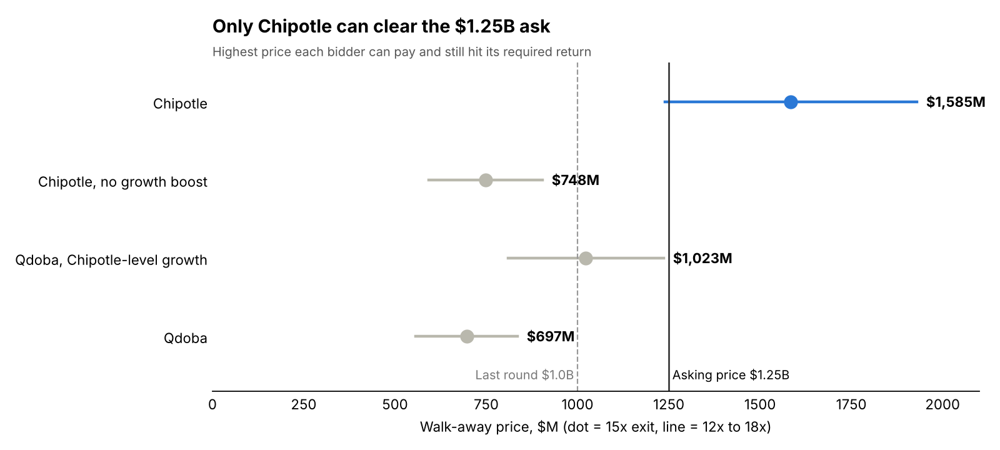
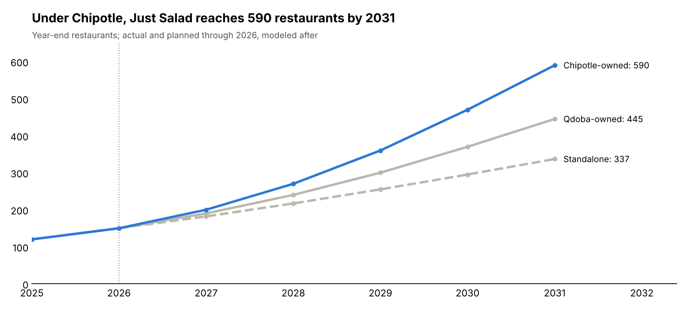
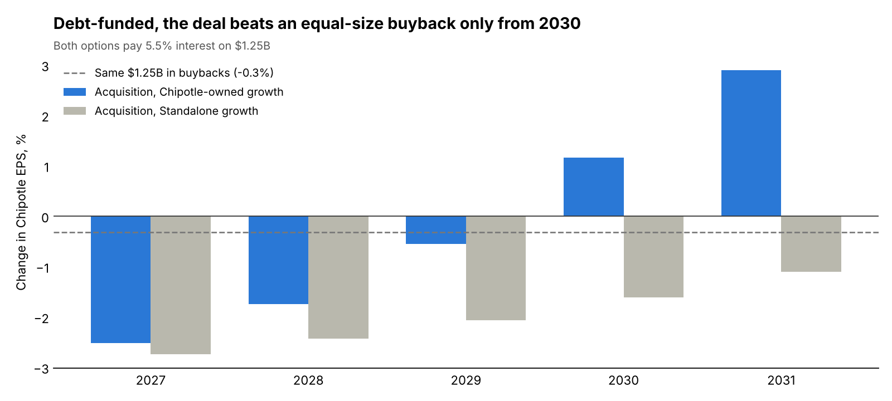
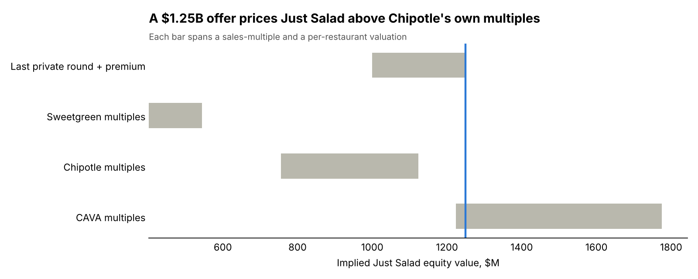

# Who Should Buy Just Salad: Chipotle or Qdoba?

*A hypothetical M&A case study · October 2026 · Mohammad (Rutgers Business School, Finance & Data Science)*

> **Hypothetical.** Neither Chipotle nor Qdoba has announced, proposed or reportedly explored a deal for Just Salad. Company and market figures are real and sourced in [`data/inputs.csv`](data/inputs.csv). Deal terms, required returns and projections are my modeling assumptions.

📄 **Full write-up:** [`report/case-study.pdf`](report/case-study.pdf)

## Verdict

**Chipotle is the better owner, but it shouldn't pay $1.25 billion in one step.**

- Chipotle can pay up to about **$1.6B** and still earn its ~9% cost of capital. Qdoba's private-equity owner, Butterfly Equity, can justify only about **$0.7B** at a ~20% hurdle.
- About **$840M** of that gap is growth: Chipotle can open Just Salad restaurants roughly twice as fast. The rest is cheaper capital. Even at Chipotle's growth pace, Qdoba tops out near $1.0B.
- Funded with debt, the deal trails an equal-size Chipotle buyback until **2030**.
- **Recommendation:** Chipotle takes a 20–30% stake now with the right to buy the rest. Qdoba pursues a franchise-development partnership instead.



## The three companies

| Metric | Chipotle | Qdoba | Just Salad |
| --- | --- | --- | --- |
| Sales, 2025 | $11.9B revenue | $1.27B system sales | $195M revenue (prelim.) |
| Restaurants | 4,201 | ~865 | 125+ |
| Ownership model | ~100% company-owned | ~79% franchised | nearly all company-owned |
| Owner | Public, no debt, ~$37.8B mkt cap | Butterfly Equity (PE), $435M securitization | Private, ~$1.0B valuation (2025) |

## Model

| Step | What it does |
| --- | --- |
| Trading comps | CAVA, Chipotle and Sweetgreen sales multiples and value per restaurant, applied to Just Salad |
| Growth scenarios | Unit openings and margins for 2027–2031: standalone, Qdoba-owned, Chipotle-owned |
| Walk-away price | Highest price at which each bidder hits its required return (Chipotle 9% unlevered; Qdoba 20% equity with $150M debt), at 12x / 15x / 18x exit EBITDA |
| EPS test | Chipotle EPS accretion/dilution vs. spending the same $1.25B on buybacks |





## Run it

```bash
pip install -r requirements.txt
python model/model.py
```

It prints every table and regenerates the charts in `charts/`. All assumptions sit in the `ASSUMPTIONS` and `SCENARIOS` blocks at the top of [`model/model.py`](model/model.py), so you can change a hurdle rate or opening pace and rerun.

## Repository layout

```
data/inputs.csv        sourced market and company figures (with URLs and dates)
model/model.py         comps, scenarios, walk-away prices, EPS test, charts
charts/                generated PNGs
report/case-study.pdf  full write-up
```

## Limitations

- Just Salad and Qdoba are private; their figures come from company statements and trade press, not audited filings.
- Peer multiples use market cap rather than enterprise value and ignore lease liabilities.
- Growth paths, margins, hurdle rates and exit multiples are assumptions. The ranges in the charts show how sensitive the answer is to the exit multiple.
